<p align="center">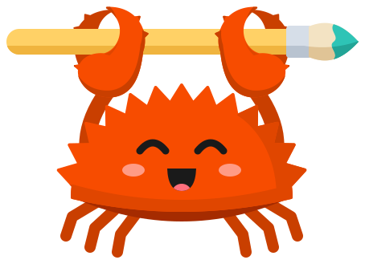</p>
<h1 align="center">paint.rs</h1>
<p align="center">An open source, clean-room reimplementation of Paint.NET for Windows, macOS, Linux, and the web.</p>

<p align="center">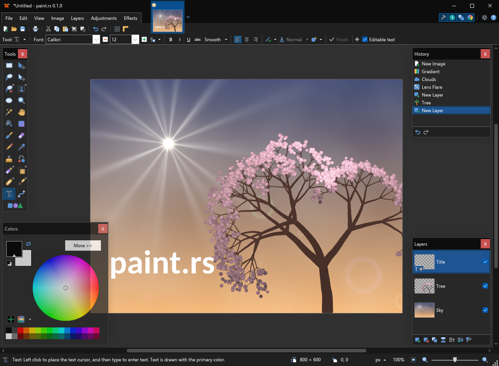</p>

---

## Screens

The main picture is made in paint.rs itself. Some screenshots use public-domain photographs and
paintings from The Metropolitan Museum of Art, and a CC0 photograph from Wikimedia Commons.

<table>
  <tr>
    <td width="50%">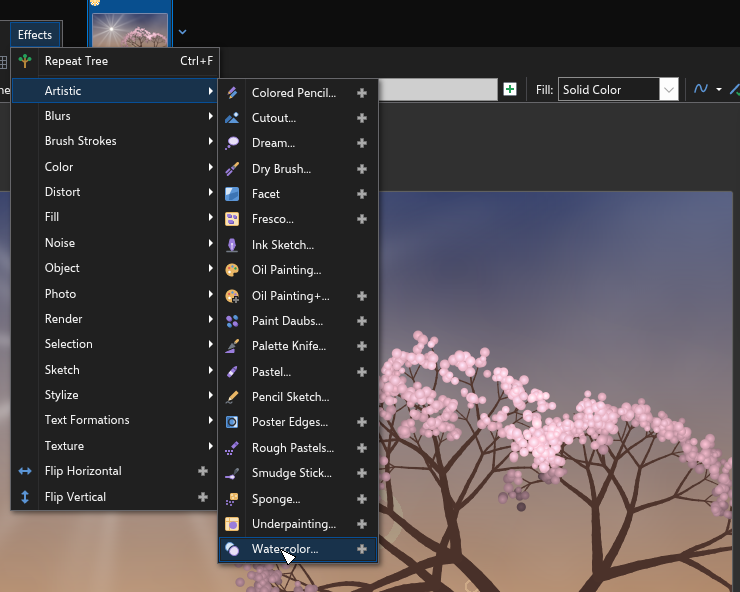<br><b>Effects menu</b>: Paint.NET's effects, then the plugins and PhotoCraft's additions, both marked with a gray plus</td>
    <td width="50%">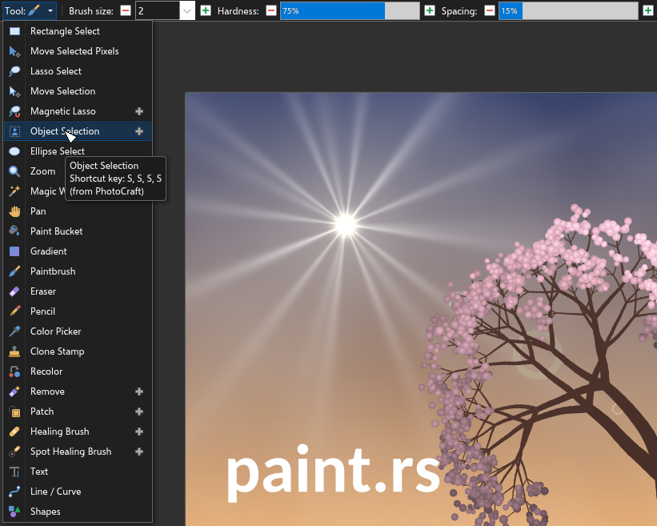<br><b>Tools</b>: Paint.NET's tools and six from PhotoCraft (plus)</td>
  </tr>
  <tr>
    <td>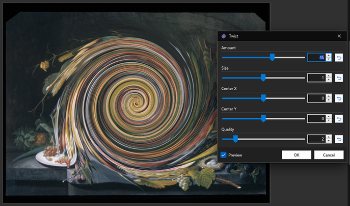<br><b>Live preview</b>: Paint.NET's Twist on a painting while its dialog is open</td>
    <td>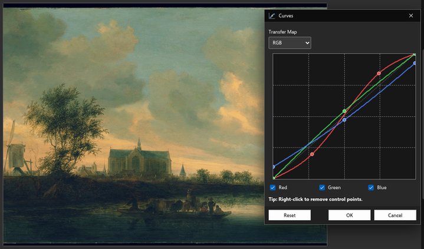<br><b>Curves</b>: per-channel curves on a painting</td>
  </tr>
  <tr>
    <td>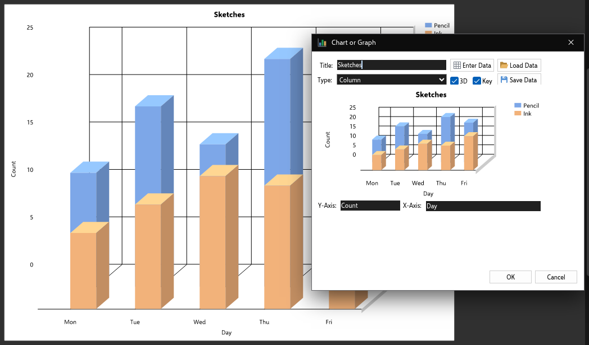<br><b>Chart or Graph</b>: a plugin, here 3-D columns</td>
    <td>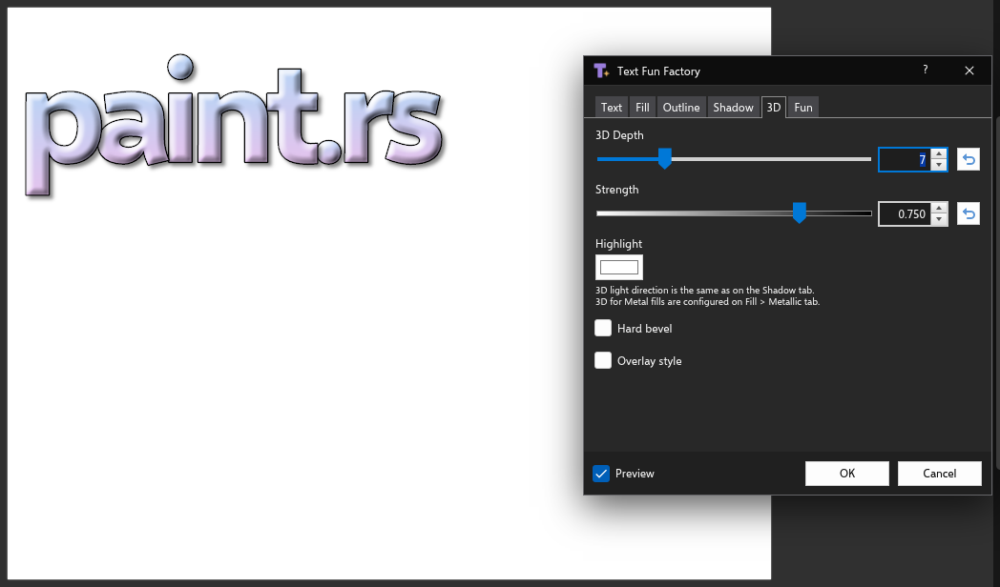<br><b>Text Fun Factory</b>: a plugin, with a gradient fill and 3-D bevel</td>
  </tr>
  <tr>
    <td>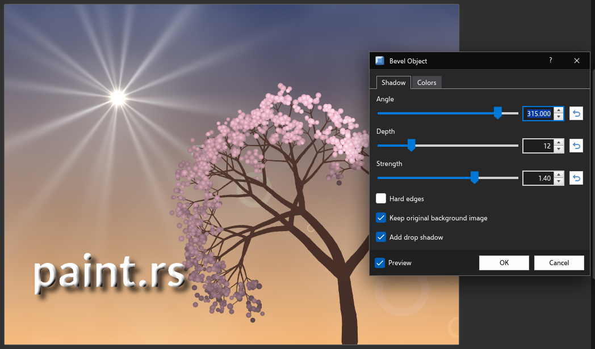<br><b>Bevel Object</b>: a plugin, here on the title with a drop shadow</td>
    <td>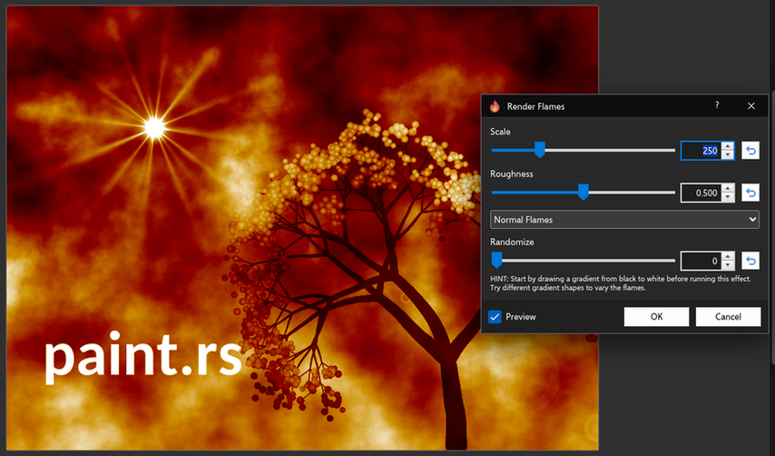<br><b>Flames</b>: a plugin that paints flames over the picture</td>
  </tr>
</table>

---

## What it is

paint.rs is a free and open source photo editor in the style of Paint.NET, for Windows, macOS,
Linux and the web. It adds features Paint.NET is missing: Linux support, content-aware fill, object
selection, healing brushes, many more effects, text that stays editable after you place it, etc.

paint.rs is an independent project and is not affiliated with Paint.NET or dotPDN LLC. All of its
icons and artwork are original.

---

## From PhotoCraft

These features come from PhotoCraft. In the app they're marked with a gray plus.

<table>
  <tr>
    <td width="50%">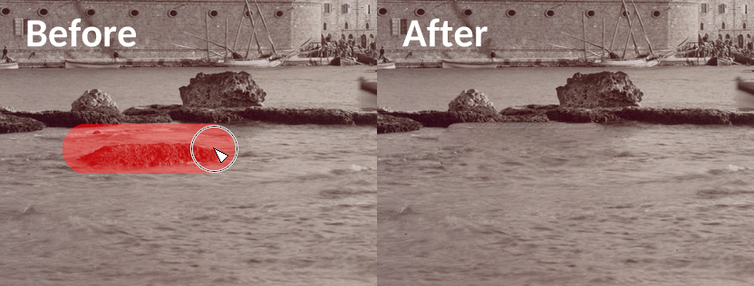<br><b>Remove</b>: brush over a rock in the water and press Enter. It's filled from the water around it.</td>
    <td width="50%">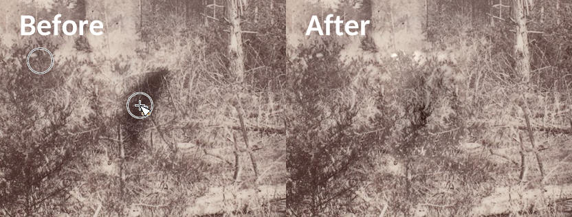<br><b>Healing Brush</b>: Ctrl+click a source, then paint over the stain. The texture is copied and blended in.</td>
  </tr>
  <tr>
    <td>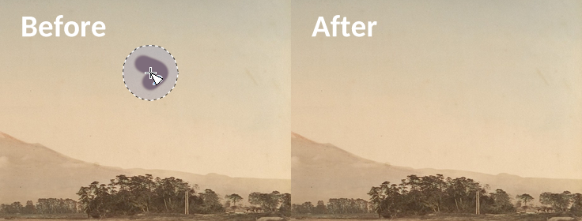<br><b>Patch</b>: lasso a stain, then drag the selection onto clean sky</td>
    <td>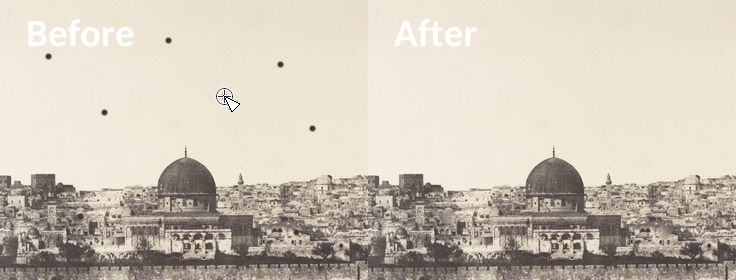<br><b>Spot Healing Brush</b>: one click on each dust speck</td>
  </tr>
  <tr>
    <td>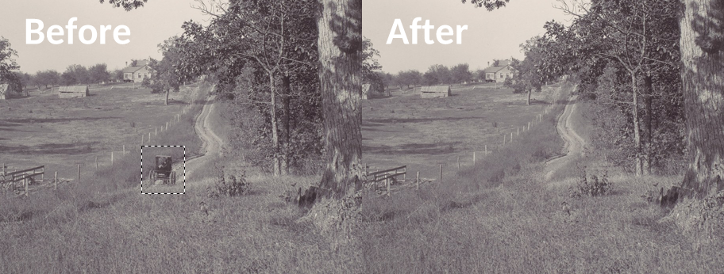<br><b>Content-Aware Fill</b>: the selected carriage filled from the road around it</td>
    <td>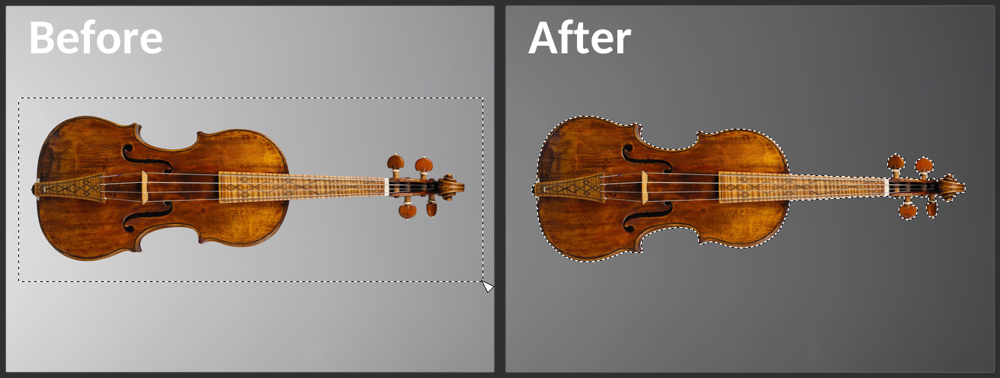<br><b>Object Selection</b>: drag a box around an object and it's selected for you. Uses MobileSAM or GrabCut.</td>
  </tr>
  <tr>
    <td>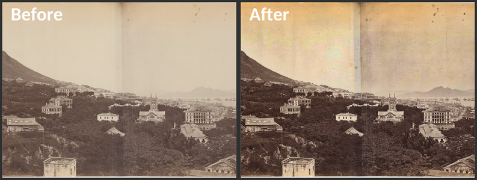<br><b>Camera Raw</b>: more contrast, clarity, dehaze and vibrance on an 1869 photograph</td>
    <td>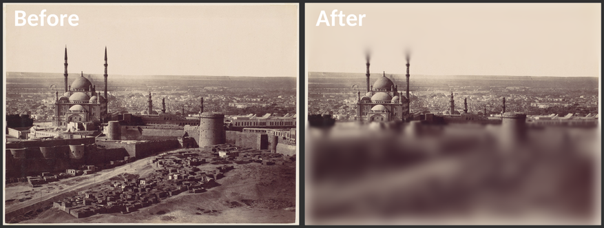<br><b>Tilt-Shift</b>: a sharp band through the mosque between two blurs, like a miniature</td>
  </tr>
  <tr>
    <td>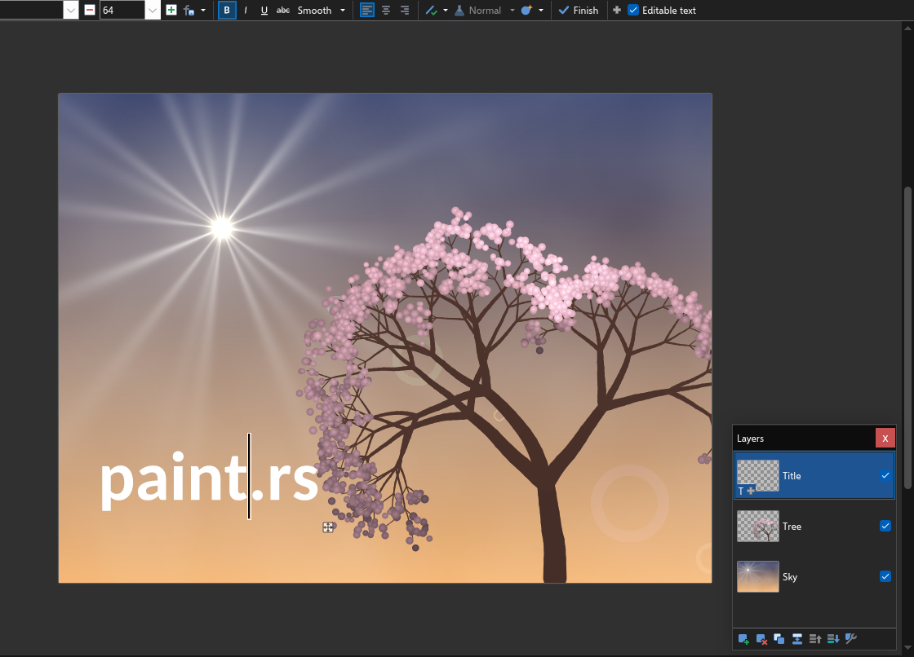<br><b>Editable text</b>: text stays editable after you place it, until you rasterize it</td>
    <td>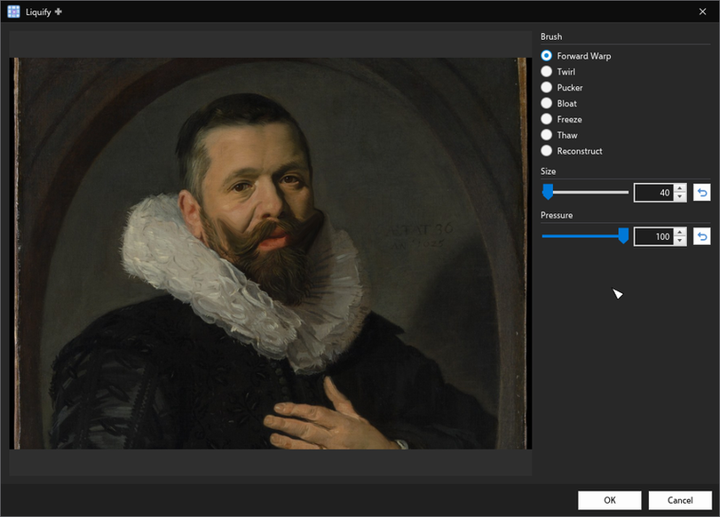<br><b>Liquify</b>: two Forward Warp strokes curl the moustache up</td>
  </tr>
  <tr>
    <td>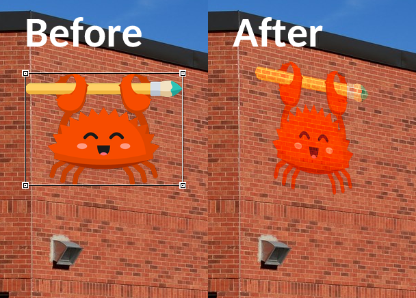<br><b>Perspective Warp</b>: the paint.rs logo on its own layer, its corners dragged onto a brick wall, then set to Overlay so it looks painted on</td>
    <td>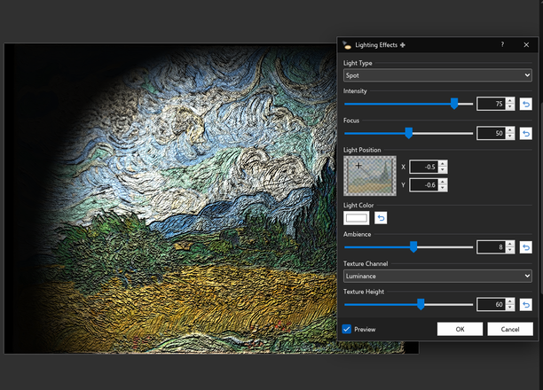<br><b>Lighting Effects</b>: a spot light on a painting, its brushwork as the texture</td>
  </tr>
</table>

**Tools**

- Magnetic Lasso, Remove, Patch, Healing Brush and Spot Healing Brush.
- Object Selection (with Object Finder and Select Subject) using [MobileSAM](https://github.com/chaoningzhang/mobilesam)
- Clone Stamp's **Aligned** and **Sample: Layer / Image** options.
- **Perspective Warp** (Layers menu) on the canvas: drag the corners to fit an image onto a
  surface. Straighten and Crop to plane flatten an angled photo.
- Move Selected Pixels' **Resize / Warp** option. With Resize, a corner scales the selection as in
  Paint.NET. With Warp, a corner moves on its own to put the selection in perspective.
- **Editable text**: text stays editable after you place it. Click it with the Text tool to change
  it. Painting on it or applying an effect asks to turn it into normal pixels first. Saved .pdn
  files keep the text editable.

**Menus**

| Menu | Additions |
|---|---|
| Edit | Fade, Fill Selection (Content-Aware) |
| Layers | Rasterize Text Layer, Puppet Warp, Perspective Warp |
| Adjustments | Auto Color, Auto Contrast, Black and White Mixer, Camera Raw, Channel Mixer, Color Lookup, Equalize, Gradient Map, HDR Toning, Match Color, Photo Filter, Selective Color, Threshold, Vibrance |
| Effects ▸ Artistic | Colored Pencil, Cutout, Dry Brush, Facet, Fresco, Paint Daubs, Palette Knife, Poster Edges, Rough Pastels, Smudge Stick, Sponge, Underpainting, Watercolor |
| Effects ▸ Blurs | Average, Field Blur, Iris Blur, Path Blur, Shape Blur, Spin Blur, Tilt-Shift |
| Effects ▸ Brush Strokes (new) | Accented Edges, Angled Strokes, Crosshatch, Dark Strokes, Ink Outlines, Spatter, Sprayed Strokes, Sumi-e |
| Effects ▸ Color | HSB/HSL, NTSC Colors |
| Effects ▸ Distort | Color Halftone, Displace, Glass, Halftone Pattern, Liquify, Mezzotint, Ocean Ripple, Offset, Pointillize, Polar Coordinates, Ripple, Shear, Vanishing Point, Wave, ZigZag |
| Effects ▸ Noise | Dust & Scratches, Film Grain |
| Effects ▸ Object | Color Decontaminate, Color to Alpha, Defringe, Remove Black Matte, Remove White Matte |
| Effects ▸ Photo | De-Interlace, Diffuse Glow, Lens Correction, Relight, Smart Sharpen |
| Effects ▸ Render | Fibers, Flame, Lens Flare, Lighting Effects, Picture Frame, Tree |
| Effects ▸ Sketch (new) | Bas Relief, Chalk & Charcoal, Charcoal, Chrome, Conté Crayon, Graphic Pen, Note Paper, Photocopy, Plaster, Reticulation, Stamp, Torn Edges, Water Paper |
| Effects ▸ Stylize | Custom Kernel, Extrude, Glowing Edges, High Pass, Neon Glow, Plastic Wrap, Solarize, Tiles, Trace Contour, Wind |
| Effects ▸ Texture (new) | Craquelure, Grain, Mosaic Tiles, Patchwork, Stained Glass, Texturizer |

---

## Other Plugins (inspired by BoltBait)

paint.rs also has 47 plugins inspired by [BoltBait's Paint.NET plugin pack](https://www.boltbait.com/pdn/). In menus they carry
the same gray plus as PhotoCraft's additions.

| Menu | Additions |
|---|---|
| Adjustments | Black and White+, Color Balance, Combined Adjustments, Hue / Saturation+, Transparency |
| Effects | Flip Horizontal, Flip Vertical |
| Effects ▸ Artistic | Dream, Oil Painting+, Pastel |
| Effects ▸ Blurs | Gaussian Blur+ |
| Effects ▸ Color | Complementary Colors |
| Effects ▸ Fill (new) | From Clipboard, From File |
| Effects ▸ Object | Apply Mask, Bevel Object, Drop Shadow+, Feather Object, Inner Shadow, Outline Object, Paste Alpha, Switch Alpha to Gray, Switch Gray to Alpha |
| Effects ▸ Photo | Combined Photo Effects, Level Horizon / Plumb Bob, Meme Maker, Remove Dust, Seam Carving - Horizontal, Seam Carving - Vertical, Sharpen Classic, Sharpen Landscape, Vignette+ |
| Effects ▸ Render | Calendar, Chart or Graph, Dimensions, Flames, Gradient, Grid / Checkerboard, Polygon / Stars |
| Effects ▸ Selection (new) | Bevel Selection, Blur Selection Edge, Feather Selection, Inner Shadow, Outline Selection |
| Effects ▸ Stylize | Edge Detect Classic, Floyd-Steinberg Dithering |
| Effects ▸ Text Formations (new) | Text Fun Factory |

---

## Forum Plugins (inspired by dpy and Tanel)

Eight more plugins follow two packs from the Paint.NET forum:
[dpy's plugin pack](https://forums.paint.net/topic/16643-dpys-plugin-pack-2014-05-04/) for text along a
shape, and [Tanel's photo and color plugins](https://forums.paint.net/topic/11619-tanels-photo-and-color-plugins-2012-03-05/).
They carry the same gray plus. Sharpen+ takes the place of PhotoCraft's Unsharp Mask, and Tanel's
Color to Alpha is named Color Range to Alpha beside PhotoCraft's Color to Alpha.

| Menu | Additions |
|---|---|
| Effects ▸ Color | Color Range to Alpha |
| Effects ▸ Photo | Sharpen+ |
| Effects ▸ Text Formations (new) | Circle Text, RotateText, RotateTextSUI, SpiralText, WaveText, WaveTextSUI |

---

## Download

Builds for Linux, Windows, macOS and the web are on the
[Releases](https://github.com/daijro/paint.rs/releases) page.

- The plain x86-64 downloads run on any x86-64 CPU. The `-avx2` ones are faster but need AVX2 (most
  Intel Core CPUs since 2013 and AMD CPUs since 2015, but not every Pentium, Celeron or Atom). If
  unsure, take the plain one.
- On Linux, the `.AppImage` is the whole app in one file. Make it executable with `chmod +x` and
  run it. It needs FUSE, which most desktops have. Without FUSE, run it with
  `--appimage-extract-and-run`. The Linux downloads need glibc 2.35 or newer (Ubuntu 22.04,
  Debian 12, Fedora 36 or later).
- For a launcher entry and the taskbar icon, use AppImageLauncher, or run the AppImage once with
  `--appimage-extract` and then
  `sh squashfs-root/usr/share/paint.rs/scripts/linux-install-desktop.sh /path/to/the.AppImage`.
  You can delete `squashfs-root` after that.
  From the `.tar.gz`, run `sh scripts/linux-install-desktop.sh ./paintrs` once.
- The macOS and Windows builds are unsigned, so the system warns the first time you open them.
  The macOS download needs macOS 11 or newer.
- Pen tablets paint with pressure on every platform. On a Wayland desktop with a pen plugged in,
  the app opens its window through Xwayland, because Wayland gives a pen only to apps that speak
  its tablet protocol. Set `PAINTRS_NATIVE_WAYLAND=1` to stay on Wayland without pressure.
- In the Linux `.tar.gz` and the Windows `.zip`, keep `paintrs` beside its `assets` folder. The
  fonts load from there.
- If the Windows app doesn't start, the reason is in `%LOCALAPPDATA%\paint.rs\startup.log`. Attach
  that file when you report the problem. Setting the environment variable
  `PAINTRS_RENDERER=software` makes it draw without the graphics card. If there is no log at all,
  use the download without `-avx2`.

---

## Build from source

You need Rust 1.99.1 (rustup reads it from `rust-toolchain.toml`), a C/C++ compiler, CMake,
pkg-config and dav1d 1.3 or newer.

| System | Install first |
|---|---|
| Ubuntu 24.04 | `sudo apt install build-essential cmake clang pkg-config libdav1d-dev libxkbcommon-dev libwayland-dev libgtk-3-dev` |
| macOS | `brew install dav1d pkgconf cmake` |
| Windows | Visual Studio's C++ tools with ClangCL, then `vcpkg install dav1d:x64-windows pkgconf:x64-windows` |

Then build and run:

```sh
cargo run --release -p paintrs
```

- **Linux:** for the launcher entry and taskbar icon, run
  `sh scripts/linux-install-desktop.sh target/release/paintrs` once.
- **macOS:** `sh scripts/macos-bundle.sh target/release/paintrs paint.rs.app` makes an app bundle.
- **Windows:** set `PKG_CONFIG` to vcpkg's `pkgconf.exe` and `PKG_CONFIG_PATH` to its
  `lib/pkgconfig`, and put its `bin` folder on `PATH`.

Linux is the most tested platform.

---

## Web

Run it locally:

```sh
rustup target add wasm32-unknown-unknown
cargo install trunk --version 0.21.14 --locked
trunk serve --locked
```

Build the site into `dist/` (needs Trunk, `wasm-opt`, gzip and Python 3):

```sh
tools/web-dist.sh          # build
tools/web-dist.sh --zip    # also write a zip
```

- The site works from any folder of a web server. Example configs for nginx, Caddy and Cloudflare
  are in `deploy/`.
- Serve it over HTTPS or localhost. Otherwise the clipboard won't work and the MobileSAM model is
  downloaded again each time it's picked.
- `dist/models/` holds the MobileSAM model (41 MB). Browsers only fetch it when someone picks
  MobileSAM for Object Selection.
- It runs in Chrome 96, Firefox 113, Safari 16.4 and newer.

---

## Opening and saving

| Format | Open | Save |
|---|---|---|
| Paint.NET (`.pdn`), with its layers | Yes | Yes |
| PNG, JPEG, BMP, TIFF, TGA | Yes | Yes |
| GIF | Yes, the first frame | Yes |
| WebP, AVIF | Yes | Yes |
| JPEG XL | Yes | Yes (lossless only on the web) |
| DDS | Yes | Yes, uncompressed 32-bit |
| HEIC / HEIF, JPEG XR | Yes | No |
| Photoshop (`.psd`, `.psb`), with its layers | Yes | Yes |

Photoshop files open as Paint.NET's PSD plugin opens them: every layer with its name, opacity,
visibility, blend mode and masks, groups as "Layer Group" marker layers, and shape layers in their
colour. Text opens as Photoshop last drew it; layer styles, adjustment layers and gradient or
pattern fills are left out. Saving writes the layers back, and the marker layers as groups.

ICO isn't supported. Colour profiles and EXIF metadata aren't kept. The DPI is.

---

## License

paint.rs is free software under the [GNU GPL v3.0 or later](LICENSE). Third-party parts keep
their own licences, listed in [LICENSE.md](LICENSE.md) and [NOTICE.md](NOTICE.md).

---

## Credits

- **[Paint.NET](https://www.getpaint.net/)** by Rick Brewster and dotPDN LLC, the editor paint.rs
  is modelled on. **No artwork or icons are taken from Paint.NET.** paint.rs is not affiliated
  with it.
- **[BoltBait's Paint.NET Plugin Pack](https://www.boltbait.com/pdn/)**, the inspiration for the plugins. No BoltBait code or
  artwork is included.
- **dpy's plugin pack** and **Tanel's photo and color plugins** from the Paint.NET forum, the
  inspiration for the forum plugins. None of their code or artwork is included.
- **[paint.js](https://github.com/LabyStudio/paintdotjs)** by LabyStudio, a reference during
  development. Some code is adapted from it under its MIT licence. None of its artwork is used.
- **PhotoCraft** by the ArtCraft Team and contributors (MIT), the source of the additions above.
- **[MobileSAM](https://github.com/chaoningzhang/mobilesam)** by Chaoning Zhang and contributors
  (Apache-2.0), the model behind Object Selection. It is built into the desktop app.
- **The Metropolitan Museum of Art** (CC0) and **Wikimedia Commons** (a CC0 photo by Raysonho)
  for the pictures in the screenshots. [SOURCES.md](assets/readme-sources/SOURCES.md) lists each.
